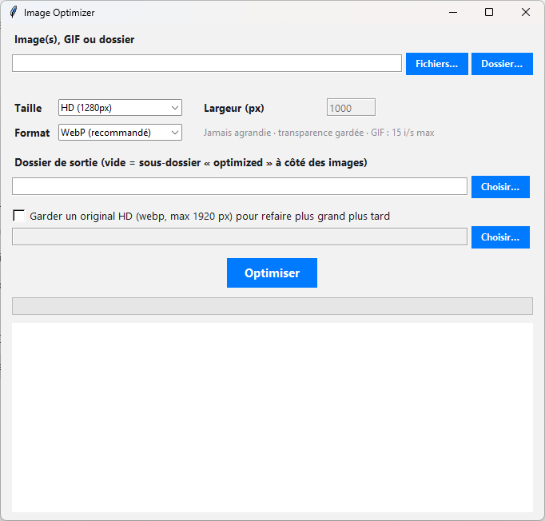

# Image Optimizer

Petit outil Windows qui prépare des images pour le web ou pour une base de notes (Anytype, Notion…).
Il les convertit en **WebP** et les réduit à la bonne largeur selon leur usage (icône, logo, image de page,
plein écran). Il garde la transparence et transforme les GIF en WebP animé plus léger. En option, il garde
aussi un original HD pour pouvoir refaire une version plus grande plus tard.

Tout se fait sur le PC : aucune connexion, aucun compte, aucune clé.



## Télécharger

[**ImageOptimizer.exe**](https://github.com/efi-labs/image-optimizer/releases/latest/download/ImageOptimizer.exe)
(Windows 10 et 11, environ 19 Mo, rien à installer). Toutes les versions sont sur la page
[Releases](https://github.com/efi-labs/image-optimizer/releases).

L'exe n'est pas signé : au premier lancement, Windows SmartScreen peut afficher « Windows a protégé votre
ordinateur ». Cliquez sur **Informations complémentaires**, puis **Exécuter quand même**. Si vous préférez,
lancez l'outil depuis le code source (voir plus bas).

## Utiliser l'interface

1. **Image(s), GIF ou dossier** : **Fichiers…** pour choisir une ou plusieurs images, **Dossier…** pour
   prendre toutes les images d'un dossier. On peut aussi coller des chemins séparés par `;`.
2. **Taille** : la largeur maximale, selon l'usage de l'image.
3. **Format** : **WebP** (recommandé), ou **Garder le format** d'origine (JPEG, PNG ou GIF optimisé).
4. **Dossier de sortie** : vide, les images vont dans un sous-dossier `optimized` à côté des originales.
5. **Garder un original HD** (option) : une copie WebP de haute qualité, à la taille d'origine plafonnée à
   1920 px, dans le dossier choisi. Ce dossier est retenu pour la fois suivante.
6. **Optimiser** : la barre avance image par image. Le journal donne, pour chaque image, la largeur et le
   poids avant et après, puis le gain total.

Une image illisible n'arrête pas le lot : elle est signalée dans le journal, et les autres sont traitées.

### Tailles

| Taille | Largeur max | Pour |
|---|---|---|
| Icon | 128 px | icône, petit logo carré |
| Logo | 300 px | logo, vignette |
| Classic | 800 px | image dans le texte d'une page |
| HD | 1280 px | image large d'une page (par défaut) |
| Semi HD | 1400 px | capture d'écran détaillée |
| Full HD | 1920 px | image plein écran |
| Personnalisée | au choix | |

### Règles appliquées

- Une image n'est **jamais agrandie** : si elle est déjà plus petite que la taille choisie, elle garde sa taille.
- La **transparence** est gardée (PNG ou WebP transparent → WebP transparent).
- Les **GIF animés** passent en WebP animé, ou restent en GIF réduit avec « Garder le format ». La cadence
  est plafonnée à **15 images/s** : des images sont retirées, mais la durée de l'animation ne change pas.
- Qualité WebP 80 pour les images optimisées, 92 pour les originaux HD ; JPEG 85.
- Formats lus : JPG, PNG, WebP, GIF, BMP, TIFF.

## Ligne de commande

Le même moteur s'utilise en ligne de commande, par exemple depuis un script ou un agent IA. Il faut
[uv](https://docs.astral.sh/uv/), qui installe Pillow tout seul.

```powershell
# Analyser : format, taille, poids, transparence, animation, et s'il faut l'optimiser
uv run src/image_optimizer.py analyze photo.png capture.jpg

# Optimiser en HD (1280 px) vers le dossier out
uv run src/image_optimizer.py process photo.png --preset hd --out out

# Largeur précise, format d'origine gardé, original HD gardé à part
uv run src/image_optimizer.py process anim.gif --width 1000 --format keep --out out --originals originals
```

`analyze` signale `needs_work` quand l'image n'est pas en WebP, fait plus de 1920 px de large ou pèse
plus de 300 Ko.

Options de `process` :

| Option | Rôle |
|---|---|
| `--preset icon\|logo\|classic\|hd\|semi-hd\|full-hd` | largeur selon l'usage (ou `--width`) |
| `--width N` | largeur maximale en pixels |
| `--out DOSSIER` | dossier de sortie (obligatoire) |
| `--format webp\|keep` | WebP (par défaut) ou format d'origine |
| `--name NOM` | nom du fichier de sortie (une seule image) |
| `--originals DOSSIER` | garde aussi un original HD (WebP, max 1920 px) |
| `--manifest FICHIER.csv` | ajoute une ligne par image : date, nom, objet, preset, largeur, poids avant / après, original, note |
| `--object ID`, `--note TEXTE` | colonnes libres du manifeste (ex. l'id de la page qui affiche l'image) |

Le résultat s'affiche en JSON : chemins, dimensions, poids avant et après, nombre d'images d'un GIF.

## Depuis le code source

```powershell
uv run src/image_optimizer_gui.py
```

Construire l'exe (PyInstaller, un seul fichier, avec son icône et un raccourci dans le menu Démarrer) :

```powershell
uv run src/build_exe.py
```

## Fichiers

| Fichier | Rôle |
|---|---|
| `src/image_optimizer.py` | le moteur et la ligne de commande |
| `src/image_optimizer_gui.py` | l'interface (Tkinter) |
| `src/build_exe.py` | construit `ImageOptimizer.exe` et le raccourci du menu Démarrer |
| `src/image_optimizer.ico` | l'icône |
| `docs/interface.png` | la capture de ce README |

Le seul réglage gardé, le dossier des originaux HD, est dans `%APPDATA%\ImageOptimizer\settings.json`, hors
du dépôt.
